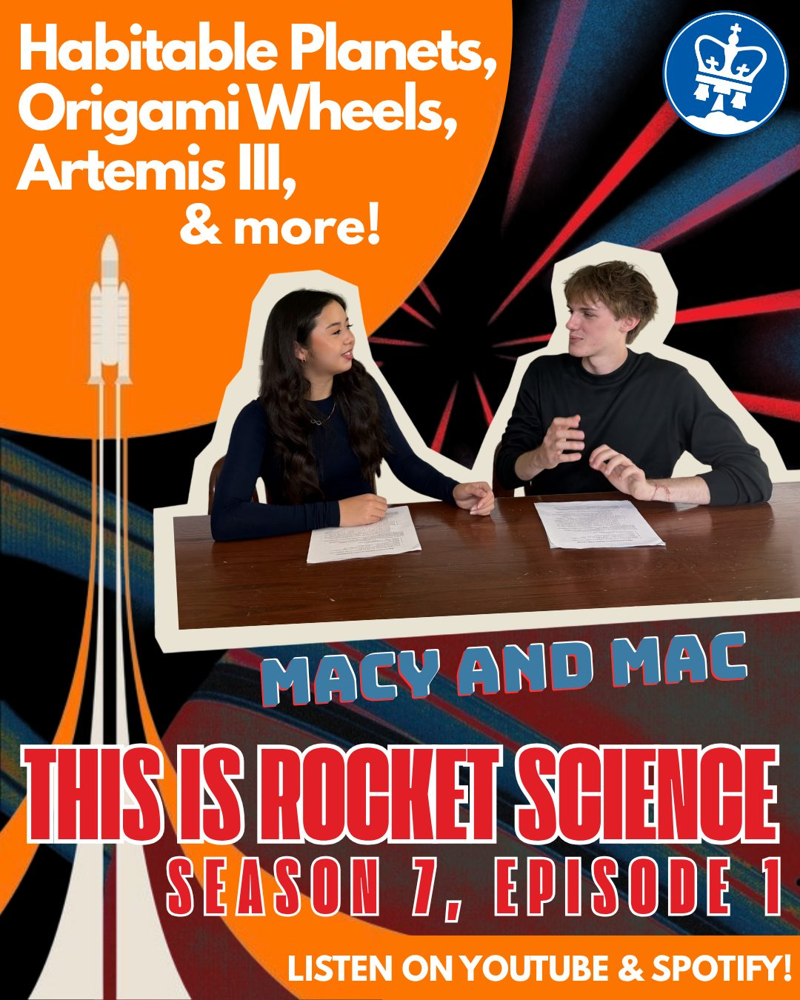

	<iframe src="https://open.spotify.com/embed/episode/4ljmBcW79cQZbWyQgSoKIP" width="100%" height="152" frameborder="0" allowfullscreen="" allow="autoplay; clipboard-write; encrypted-media; fullscreen; picture-in-picture" loading="lazy"></iframe>

Episode 39 of This is Rocket Science is out! This week we learn about origami-inspired moon wheels, an Earth-like habitable planet, updates on the Artemis III mission, and more! Please also welcome our new hosts, Mac & Macy!

	
	

    <figcaption class="text-center">
      <b>Poster for episode 39 of TiRS.</b>
    </figcaption>
  

